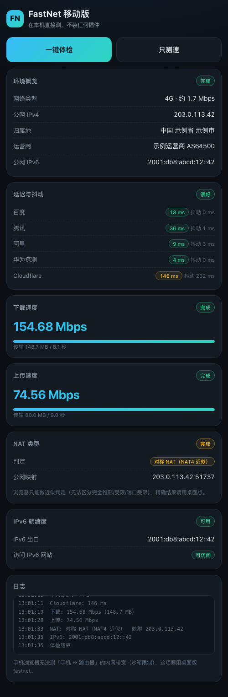

# FastNet · 本机网络体检

一个**不依赖任何服务器、拷到电脑上双击就能跑**的网络诊断工具。Windows / macOS / 安卓三端，用来快速看清「我现在这条网到底怎么样」。

- 出口 IP、运营商、IPv6 就绪度
- 到公共节点的延迟与抖动
- 上下行真实带宽（多连接并发）
- NAT 类型（完全锥形 / 受限 / 端口受限 / 对称）
- **电脑 ↔ 路由器之间的内网带宽**（含千兆跑成百兆的排查）
- 两台设备之间互测带宽（自带服务端）



> 上图是在手机浏览器里真跑出来的结果，不是设计稿。

---

## 目录

- [这是什么东西](#这是什么东西)
- [下载与安装](#下载与安装)
- [各平台使用教程](#各平台使用教程)
- [功能清单](#功能清单)
- [内网带宽测速怎么用](#内网带宽测速怎么用)
- [命令行用法](#命令行用法)
- [示例输出](#示例输出)
- [它是怎么实现的](#它是怎么实现的)
- [常见问题](#常见问题)
- [从源码编译](#从源码编译)
- [已知限制](#已知限制)
- [更新日志](#更新日志)

---

## 这是什么东西

最初是有一个路由器 WebUI 页面（FastNet Stream Console），能做上面那些检测。但它是个纯前端页面：**浏览器只负责发请求和显示，真正的检测全在路由器上跑**。这意味着：

- 必须连那台路由器、同局域网才能用；
- 离开那个网络就用不了；
- 换台设备就没了。

这个项目把那套能力**在本机重新实现了一遍**，所以现在：不需要连任何特定设备，也不需要和它同一个局域网，拷到任意一台电脑上双击就能测——测的是「**运行它的这台电脑**」的网络。

顺带说明一个容易混淆的点：

| 场景 | 测的是什么 |
| --- | --- |
| 菜单 1–6 | 这台电脑 → 公网 |
| 菜单 7 | 这台电脑 → 指定内网/上游设备 |
| 菜单 8 | 这台电脑 ↔ 路由器（一段网线/一台交换机之内） |

---

## 下载与安装

到 [Releases](https://github.com/ljp801005-tech/fastnet/releases) 下载最新的包，解压即用，**不需要装 Python、.NET、运行库**。

| 平台 | 文件 | 说明 |
| --- | --- | --- |
| Windows 10/11 x64 | `FastNet-Win-v*.zip` | 双击 `fastnet.exe` |
| macOS 10.15+ | `FastNet-mac-v*.zip` | Intel / Apple Silicon 通用，右键打开 `启动FastNet.command` |
| 安卓 8+ / iOS | `FastNet-Android-v*.html` | 用 Chrome / Safari 打开 |

---

## 各平台使用教程

### Windows

1. 解压 `FastNet-Win-v1.1.0.zip`；
2. 双击 `fastnet.exe`，出现中文菜单；
3. 按 `A` 一键体检（约 40 秒），或按数字单测某一项。

> **首次运行被 SmartScreen 拦了？** 这是没有数字签名的正常现象。点「更多信息」→「仍要运行」。
> 如果杀软报毒，把文件加白名单即可——它只做网络请求，不写注册表、不驻留。

### macOS

1. 解压 `FastNet-mac-v1.1.0.zip`；
2. **右键点 `启动FastNet.command` → 打开**（第一次必须右键，直接双击会被 Gatekeeper 拦）；
3. 之后就能正常双击了。

如果提示「无法打开，因为 Apple 无法验证」：

```bash
cd 解压目录
xattr -dr com.apple.quarantine .
./fastnet
```

启动器内部已经带了 `xattr` 清理，只有第一次需要手动放行。

### 安卓 / iPhone

手机上有两种用法，推荐第一种。

**方式一：电脑共享，手机直接打开（推荐）**

1. 电脑上运行 `fastnet.exe`（或 mac 版），在菜单里按 `W`；
2. 按提示，手机会看到一行地址，例如 `http://192.168.1.23:8899`；
3. 手机连着**同一个 Wi-Fi**，浏览器打开这个地址；
4. 浏览器菜单里选「添加到主屏幕」，之后一点就开，像 App 一样。

**方式二：只用手机，不碰电脑**

把 `FastNet-Android-v1.1.0.html` 传到手机（微信文件传输助手 / QQ / 数据线都行），用 Chrome 打开。`#auto` 结尾的地址（如 `...html#auto`）可以打开就自动开测。

> 手机端受浏览器沙箱限制，**测不了「手机 ↔ 路由器」的内网带宽**，也没有精确的 NAT1/2/3/4 判定（只能分锥形/对称）。这两项请用桌面版。页面里也写了这条提示。

---

## 功能清单

菜单项与说明：

| 菜单 | 功能 | 说明 |
| --- | --- | --- |
| `1` | 环境概览 | 本机网卡地址、公网 IPv4/IPv6、归属地、运营商（多源兜底） |
| `2` | 延迟与抖动 | TCP 握手到 5 个公共节点，丢首包，算平均/抖动/丢包 |
| `3` | 下载测速 | Cloudflare 公共端点，多线程并发，实时速率 |
| `4` | 上传测速 | 同上 |
| `5` | NAT 类型 | 自实现 STUN，输出 NAT1–NAT4 |
| `6` | IPv6 就绪度 | 本机地址 / AAAA 解析 / 真实 IPv6-only 访问，0–10 分 |
| `7` | 上游节点测速 | 指定 `IP:Port` 的 TCP 延迟 + HTTP 下载 |
| `8` | 内网带宽测速 | 电脑 ↔ 路由器，延迟 + 双向吞吐 |
| `S` | 启动测速服务端 | 让另一台电脑测本机（默认端口 5201） |
| `W` | 手机版页面共享 | 手机浏览器访问本机使用（默认端口 8899） |
| `A` | 一键完整体检 | 1–6 + 内网，最后给结论并存 JSON |
| `C` | 设置 | 测速时长、并发连接数 |

每次结果都会存到程序同目录的 `results/*.json`，含完整字段，方便留档对比。

---

## 内网带宽测速怎么用

这是很多人最关心的一项：明明办的是千兆宽带，为什么局域网传文件只有十几兆？

选菜单 `8`，程序会自动做完这几步：

1. **自动识别默认网关**（Windows 读 `route print`，macOS 读 `route -n get default`，Linux 读 `ip route`），失败则用同网段 `.1/.254` 探测；
2. **测到网关的延迟**：优先 ICMP，路由器屏蔽 ICMP 时自动退到 TCP 握手；
3. **在网关上找测速端点**：并行试 `3300 / 3200 / 8080 / 8000 / 80` 端口与多种参数写法（`/download?bytes=`、`?size=&count=`、`__down` 等）；
4. **找到就测**：4 连接并发跑 5 秒下行 + 5 秒上行，给出 Mbps 与链路利用率。

如果目标设备没有测速接口（普通路由器基本都没有），还有两条路：

| 对端 | 怎么做 |
| --- | --- |
| 另一台电脑 | 在它上面运行 `fastnet.exe serve`，然后本机选 `8`，填那台机器的 `IP:5201`。测出来的就是两台机器之间这段网线 + 交换机的真实带宽 |
| NAS / 内网服务器 | 用菜单 `7`，填它的 `IP:Port`，测 HTTP 下载速率 |

### 结果怎么解读

| 现象 | 结论 |
| --- | --- |
| 链路 1 Gbps，实测 850–950 Mbps | 正常，跑满了（千兆有效载荷本来就到不了 1000） |
| 链路 1 Gbps，实测 90–100 Mbps | **大概率网线问题**：只通了 4 芯、水晶头氧化、线材太差。换 Cat5e/Cat6 网线 |
| 链路 2.5 Gbps，实测约 940 Mbps | 两端有一端是千兆口（网卡/交换机/路由器口规格不一致） |
| 利用率低于 50% | 设备端服务性能限制、CPU 占用、或 Wi-Fi 干扰 |
| 延迟 > 10 ms | 内网延迟通常应 < 2 ms；偏高说明 Wi-Fi 信号差或有环路 |

---

## 命令行用法

菜单之外，所有功能都能直接用参数调用，适合写进脚本或定时任务：

```bash
fastnet all                          # 一键完整体检
fastnet env                          # 环境概览
fastnet latency                      # 延迟与抖动
fastnet speed                        # 上下行测速
fastnet nat                          # NAT 类型
fastnet ipv6                         # IPv6 就绪度
fastnet upstream 192.168.1.1:80      # 上游节点测速
fastnet lan                          # 内网带宽（自动找网关）
fastnet lan 192.168.1.1:3200         # 内网带宽（指定目标）
fastnet serve 5201                   # 起测速服务端
fastnet web 8899                     # 把手机版页面共享到局域网
fastnet -proxy all                   # 走系统代理（默认直连）
```

Windows 上把 `fastnet` 换成 `fastnet.exe` 即可。

---

## 示例输出

`fastnet all` 的结论部分（**示例数据**：IP、归属地与运营商均已替换为虚构值；实际每次测速结果不同，此处已删减部分行）：

```
================================================================
  体检结论
================================================================
  公网 IPv4           203.0.113.42
  位置/运营商         中国 示例省 示例市 示例运营商
  平均延迟            0.8 ms（最佳 114 DNS 0.3 ms）
  上行带宽            187.28 Mbps
  NAT 类型            完全锥形 NAT (Full Cone)
  IPv6                IPv6 全链路可用（10/10）
  本机→网关          0.40 ms（192.168.1.1）
  内网带宽            下行 931.57 Mbps / 上行 926.11 Mbps（正常）
```

内网测速的过程输出：

```
================================================================
  内网带宽测速（电脑 ↔ 路由器 / 内网设备）
================================================================
  本机地址            192.168.1.23
  默认网关            192.168.1.1
  [OK]  0.40 ms   抖动 0.05 ms   丢包 0%   （ICMP）
        正在探测目标设备上的测速端点（需设备提供 /download /upload）…
  [OK]  测速端点: http://192.168.1.1:3200  下载 /download
        上传端点: http://192.168.1.1:3200/upload
        开始测速，时长 5 秒 / 4 连接（期间请勿同时下载大文件）
  [OK]  下行（设备 → 本机）  931.57 Mbps
  [OK]  上行（本机 → 设备）  926.11 Mbps
  [OK]  吞吐正常
```

---

## 它是怎么实现的

全部用 Go 标准库手写，没有第三方依赖，单文件可执行。

**NAT 类型判定**：自己实现 STUN（RFC 5389）。先向服务器要一个映射地址，再用同一个本地端口向「另一个 IP + 另一个端口」发 `CHANGE-REQUEST`（RFC 3489）：能收到回包说明是锥形，收不到再结合「不同服务器看到的映射端口是否一致」区分受限/端口受限/对称。

**内网带宽**：先解析系统路由表拿到网关，再探测网关上是否有数据端点。测速时用多个 goroutine 各自持有一条连接循环拉数据，统计的是真实字节数，不是理论值。

**为什么结果会比理论值低一点**：TCP/IP 有包头开销，千兆链路的有效载荷上限大约 940–950 Mbps，这不是程序算错了。

**测速前的出口体检（v1.1.1 起）**：公网测速报出来的必须是本机宽带的吞吐，不能是代理节点的吞吐。程序会先检查代理环境变量、Windows 系统代理（注册表 `ProxyEnable`）、TUN 虚拟网卡，再用**和测速完全相同的 HTTP 客户端**请求 `speed.cloudflare.com/cdn-cgi/trace`，比较测速目标出口与本机宽带出口的地区 / IP。发现代理痕迹时，先尝试绑定物理网卡源地址强制直连；确认不了直连就**跳过该项测速**并在报告里写明原因，而不是给一个看似正常、其实完全失真的数字。

> 注意：环境概览里的公网 IP 来自国内直连站点，而测速目标可能按分流规则走代理，两者出口可以不同。所以不能用「环境概览显示的是运营商 IP」来推断测速也是直连。

---

## 常见问题

**测出来的 IP 和运营商不对，显示成海外机房？**
说明这台机器开了全局代理 / TUN。程序测的是实际出口，所以结果代表代理服务器，不代表你的宽带。关掉代理再测。程序检测到代理环境时会提示，并且公网测速会被自动跳过（见下一条）。

**为什么下载/上传显示「已跳过（代理环境，不测代理链路）」？**
测速目标 `speed.cloudflare.com` 的实际出口与本机宽带出口不一致，常见于 Clash 分流规则或 TUN 全局模式。这时测出来的是「代理节点 → Cloudflare」的速率，跟你的 1000M 宽带没有关系，所以程序宁可不报，也不会给一个看似正常的假带宽。处理方式三选一：

1. 关闭系统代理与代理软件的 TUN 模式后重测；
2. 在代理软件里把 `speed.cloudflare.com` 加入直连规则；
3. 只想排查内网瓶颈，用菜单 8「内网带宽测速」，它不走公网、不受代理影响。

确需诊断代理链路本身，可加 `-force-speed` 强制测速，控制台会明确标注结果不代表宽带带宽。

**为什么 `speed.cloudflare.com` 偶尔测速失败，提示「数据不足」？**
连续测太多次会被限流（HTTP 429）。程序会明确报错而不是给你假数字，等 1–2 分钟再测。

**需要管理员/root 权限吗？**
不需要。延迟优先用系统自带的 `ping`（它本身有权限），NAT 与测速都是普通用户可用的 UDP/TCP 连接。

**Windows 上端口被防火墙拦了？**
只有 `serve` 和 `web` 两个模式需要入站放行。首次运行系统弹窗时选「允许专用网络」即可。

**结果存在哪？**
程序同目录的 `results/` 文件夹，每次一个 JSON。不想留档直接删就行。

**能测出我实际带宽的「理论最大值」吗？**
不能。测的是「此刻能跑到的速率」，受对端服务器、线路拥塞、Wi-Fi 质量影响。多测几次取较高值更接近真实上限。

**手机上为什么没有内网带宽测试？**
浏览器沙箱不允许网页任意穿透内网拿数据，这是安全设计，不是没做。

---

## 从源码编译

需要 Go 1.21 或更高版本，无需 CGO。

```bash
git clone https://github.com/ljp801005-tech/fastnet.git
cd fastnet

# 本机直接跑
go run . all

# 交叉编译三端
./build.sh
```

手动编译单平台：

```bash
# Windows 64 位
GOOS=windows GOARCH=amd64 CGO_ENABLED=0 go build -trimpath -ldflags "-s -w" -o fastnet.exe .

# macOS 通用二进制
GOOS=darwin GOARCH=arm64 CGO_ENABLED=0 go build -trimpath -ldflags "-s -w" -o fn-arm64 .
GOOS=darwin GOARCH=amd64 CGO_ENABLED=0 go build -trimpath -ldflags "-s -w" -o fn-amd64 .
lipo -create -output fastnet fn-arm64 fn-amd64
```

源码结构：

| 文件 | 作用 |
| --- | --- |
| `main.go` | 菜单、环境、延迟、上下行测速、NAT、IPv6、上游测速、报告 |
| `lan.go` | 内网带宽：网关识别、端点探测、双向吞吐、测速服务端 |
| `web.go` | 把手机版页面共享到局域网 |
| `console_windows.go` | Windows 控制台 UTF-8 + ANSI + 隐藏子进程黑框 |
| `console_other.go` | 其他平台占位 |
| `mobile/FastNet-Android.html` | 单文件移动版页面 |

---

## 已知限制

- 测的是**运行它的这台电脑**的网络，不是路由器的。想看路由器到公网的状态，只能在路由器上跑。
- 手机端（网页版）无法测内网带宽，NAT 只能分锥形/对称。
- Cloudflare 端点会有速率波动与限流，单次结果仅供参考。
- 只支持 IPv4 的内网带宽测试；IPv6-only 环境下的内网互通未覆盖。
- 二进制未做数字签名，首次运行需要手动放行（见上文各平台说明）。

---

## 更新日志

**v1.1.1**
- 新增「测速出口体检」：检测代理环境变量、Windows 系统代理（注册表）、TUN 虚拟网卡，并比对测速目标出口与本机宽带出口
- 检测到代理且无法确认直连时**自动跳过公网测速**，JSON 报告写入 `skipped` / `reason` / `egress`，不再把代理链路速率报成宽带带宽
- 测速流量显式禁用 HTTP 代理，并尝试绑定物理网卡源地址绕过 TUN；成功绕过才继续测速
- 新增 `-force-speed`：明知走代理也要测，控制台明确标注结果不可信
- 环境概览补充系统代理提示；体检结论区分「已跳过」与「测速失败」

**v1.1.0**
- 新增「内网带宽测速」（电脑 ↔ 路由器），自动识别网关与测速端点，判断千兆跑成百兆
- 新增 `serve` 模式，两台设备互测带宽
- 新增安卓/iPhone 网页版与 `web` 局域网共享模式
- 新增 macOS 通用二进制（Intel + Apple Silicon）
- 修复 `serve 5201` 把端口误当主机名的问题

**v1.0.0**
- 首个版本：环境概览、延迟抖动、上下行测速、NAT 类型、IPv6 就绪度、上游测速

---

## 免责声明

本工具只做网络连通性与速率测量，不修改任何系统设置、不收集上报任何数据，结果仅保存在本地。请在你**有权测试的网络**上使用。
